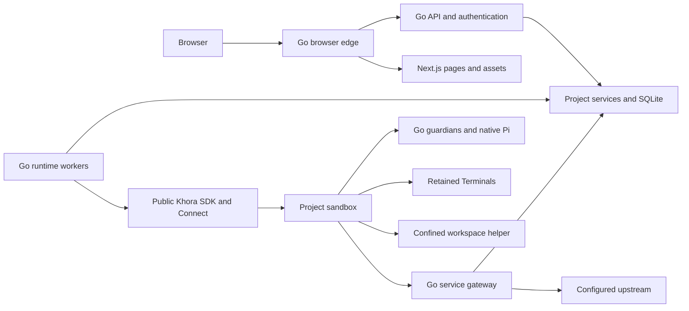

# Architecture

One `orchestrator serve --config FILE` process composes the product store,
application services and workers, cookie authentication, HTTP/SSE/WebSocket,
operator control socket, browser edge and optional service gateways. Next.js is a
separate asset/page server. The private API hop uses an owner-only Unix socket;
the edge preserves the browser Origin and replaces forwarded identity headers.

`internal/product` owns intent, permissions, projections and lifecycle decisions.
`internal/producthttp` translates authenticated requests without owning runtime
lifetimes. `internal/sandbox/khora` adapts only public engine APIs and checks
engine store identity, epochs, mutation revisions and postconditions.
`internal/application` is the executable composition; `internal/edge` is the
same-origin router. Package-boundary and removal tests enforce these layers.

A Project binds its template, runtime release digest, resource limits, complete
reachability declaration and publication mounts when first configured. Every
Agent Session and Terminal shares that Project's workspace and Linux trust domain.
The Project's runtime volume contains logically separate Session directories.
Children never own a sandbox or alter Project network policy.

Workers have bounded concurrency and separate responsibilities for Agent turns,
PTY attachment, Files, lifecycle, captures, recovery, schedules and retirement.
A database transaction records intent before a remote effect. A remote result is
applied only to its original owner/incarnation/revision. Uncertain mutations stay
uncertain until evidence settles them; a transport retry is not new user intent.

The deployment is single-owner. Database-path and alias locks reject a second
application writer. Browser reconnect, application restart and engine process
restart are recovery scenarios; they are not active-active or physical power-loss
qualification.
