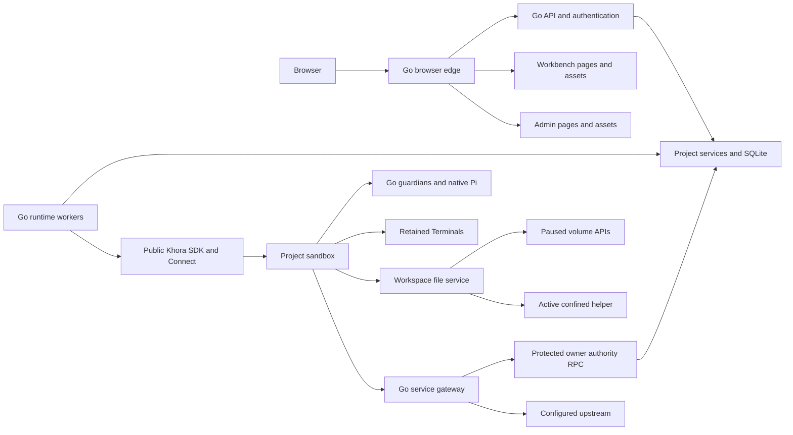

# Architecture

One `orchestrator serve --config FILE` process composes the product store,
application services and workers, cookie authentication, HTTP/SSE/WebSocket,
operator control socket and browser edge. `orchestrator gateway --config FILE`
serves declared service audiences in an independent process. Workbench and administration use independent Next.js
asset/page servers. The private API hop uses an owner-only Unix socket;
the edge preserves the browser Origin and replaces forwarded identity headers.

`internal/product` owns intent, permissions, projections and lifecycle decisions.
`internal/producthttp` translates authenticated requests and owns advisory
resource event hubs; execution lifetimes remain with product services. `internal/sandbox/khora` adapts only public engine APIs and checks
engine store identity, epochs, mutation revisions and postconditions.
`internal/application` is the executable composition; `internal/edge` is the
same-origin router. `internal/servicegateway` owns forwarding and the versioned
authority transport. The gateway opens no product Store; durable bounded request
slots preserve release accounting across owner replacement. Package-boundary and removal tests enforce these layers.

A Project binds its template, runtime release digest, resource limits, service
routes and complete owned/shared Volume plan at first resource allocation,
including a first upload before compute. Direct/DNS policy is selected
from durable accepted defaults by each creation/resume operation; it remains
fixed throughout the placement. Every
Agent Session and Terminal shares that Project's workspace and Linux trust domain.
The Project's runtime volume contains logically separate Session directories.
Children never own a sandbox or alter Project network policy.

Workers have bounded concurrency and separate responsibilities for Agent turns,
PTY attachment, Files, lifecycle, captures, recovery, schedules and retirement.
A database transaction records intent before a remote effect. A remote result is
applied only to its original owner/incarnation/revision. Uncertain mutations stay
uncertain until evidence settles them; a transport retry is not new user intent.

The deployment is single-owner. Database-path and alias locks reject a second
application writer. Browser reconnect, application restart and engine process
restart are recovery scenarios; they are not active-active or physical power-loss
qualification.

Durable ingestion commits source evidence and command state before ACK. A separate
bounded display worker materializes conversation items, revisions and changes.
Authenticated HTTP reads seek those derived indexes. The browser tracks separate
page frontiers and loaded-window budgets rather than rebuilding native journals.
A shared Project hub polls the durable outbox once, owns one advisory filesystem
watch, and fans out bounded replay envelopes. Subscriber overflow and expired
continuity require resync. No event subscription activates or pins a Project.
