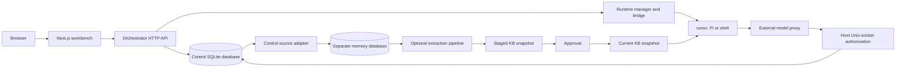

# Architecture

The platform runs long-lived sessions through replaceable gVisor generations.
The orchestrator is the authority for durable session/turn state; the browser is
a projection, and sandbox output crosses a validated file-queue bridge.

## Core ownership

| Component | Owns | Does not own |
|---|---|---|
| `internal/store` | Sessions, turns, events, schedules, auth sessions, runtime resource records, sharing metadata | Memory extraction tables or external credentials |
| `internal/server` | API policy, turn dispatch, scheduler, recovery orchestration, event publication | Sandbox OS isolation or external model implementation |
| `internal/runtime` | OCI specs, mount/network lifecycle, runsc invocation, runtime identity and cleanup | User conversation lifetime |
| `internal/bridge` | Claim/ack/output/control protocol and durable commits | Frontend state or memory extraction |
| `frontend` | Same-origin proxy and UI state | Authority over turn status or host root-owned files |
| External model/data gateways | Upstream credentials and protocol forwarding | Authority to authorize an arbitrary sandbox turn |

The model proxy authorizes requests through the orchestrator's Unix socket and
SO_PEERCRED checks. Its production implementation is an external dependency;
`dev/model-proxy` is a development adapter, not the production deployment.

## Persistence and lifecycle

`orchestrator.db` and `memory.db` are physically separate SQLite files, each with
a writer and reader pool. The control database holds messages, turn state and
runtime ownership. The memory database holds trajectories and extracted
knowledge. Cross-database ingestion uses `internal/controlsource`; no SQLite
foreign key spans these files.

A session owns persistent messages, workspace and driver home. A generation owns
compute, network, bridge/control files and temporary runtime resources. Releasing
or replacing a generation must preserve session data. See
[session lifecycle](session-lifecycle.md) and [control plane](control-plane.md).

Managed deployments verify schema on startup and require explicit offline
migration. Development store opens retain schema initialization behavior.
[Database operations](database.md) explains the distinction.

## Scheduling and optional subsystems

There are three separate mechanisms:

1. **Core maintenance:** leases, bridge polling, reconciliation and resource
   cleanup. This supports ordinary session availability.
2. **Core user scheduler:** durable `agent_schedules` and `schedule_runs`, with an
   independent ticker/worker pool, retries, timeouts and misfire handling.
3. **Optional knowledge jobs:** capture/extraction/curation in `internal/memory`
   and `internal/trajectory`, invoked by the configured pipeline or explicit
   `backfill` / `replay` CLI jobs. These are not user Cron Agent schedules.

The optional `/evolution` UI also integrates a separately maintained runner via
`EVOLUTION_*` configuration. Memory evaluation and external nightly workflows are
not part of the core runtime release contract. The repository contains integration
surfaces and an internal extraction implementation; it does not contain the
external evaluation project. See [memory and knowledge](agents-kb.md) for ownership,
configuration, data flow and failure behavior.

## Release boundary

A release packages the orchestrator, standalone frontend with Node, deployment
CLI and generic rootfs. CI runs on disposable GitHub-hosted machines. Target
machines supply their own configuration, gateways, identity and persistent data.
No production machine is a build dependency.

The deployment CLI separates artifact operations from target-local operations.
Its optional label is descriptive; paths, locks, manifest digests and migration
records establish the actual installation identity.

## Current constraints

- One orchestrator owns a configured control-plane data root at a time.
- Packaged deployment support is Linux amd64 / Ubuntu 22.04 and 24.04 / systemd.
- The KB extraction path aggregates configured users' trajectories into a shared
  knowledge store; it does not provide per-tenant KB isolation.
- External proxy/evolution behavior is not established by core source tests.
- Production data compatibility and restore verification remain local operational
  responsibilities even when release artifact tests pass.

Feature planning remains in [issue #3](https://github.com/TSHOGX/agent-runtime-platform/issues/3).

## Egress policy compilation

`internal/egress` is a pure compiler for typed model, Doris, OBS and web service
policies. Services contain protocol restrictions and an upstream reference;
credentials stay with gateways. Compilation requires explicit service operations,
dormant execution bindings, gateway protocol declarations, a private synthetic
address range and the deployment's protected network inventory.

The result contains default-deny rules, exact `/32` TCP service routes, guest
host aliases and explicit TCP/UDP DNS resolver endpoints. Direct exceptions must
name a prefix, protocol and port. Rules intersecting protected networks, synthetic
service destinations or gateway listeners are rejected, as are direct DNS rules.
The current compiler accepts IPv4; other address families fail validation. Shell
policies cannot grant model access, and data access requires explicit operations.
One listener serves one protocol, while distinct executions can use that listener
through distinct original-destination tuples.

Canonical application-policy and network-plan digests have separate scopes.
Changing model or database entitlements changes the policy digest. Changing a
placement, binding revision or synthetic destination changes the network digest.
Equivalent ordering and duplicate set members produce identical results. The
compiler performs no name resolution, socket I/O, route installation or grant
activation; architecture tests enforce its dependency boundary.

The existing sandbox backend still consumes persisted legacy rule strings; the
compiler is independently exercised by contract tests. Those tests establish
policy construction, not gateway provenance or kernel enforcement. The legacy
allocator's policy identity now includes unrestricted egress explicitly, so
restricted and `allow_all` policies cannot share an identity.

## Workspace mutation boundary

`internal/workspace` owns relative-path policy and the portable replacement
interface. The local adapter in `internal/workspace/local` owns host descriptors
and file ownership. Upload and edit handlers resolve a verified workspace and
pass a stream through that interface; they no longer create directories or stage,
chmod, chown and rename files themselves.

The local adapter walks directories using pinned descriptors and `O_NOFOLLOW`,
then stages and renames relative to the final directory descriptor. A path
component swapped for a symlink cannot redirect the write. Newly created
parents are synchronized, file metadata is applied before the file sync, and the
parent is synchronized after rename. A failure before rename preserves the old
file. A failure after rename returns an uncertain outcome and a content digest
for reconciliation. These are native Linux file-operation guarantees; the tests
are not power-loss or Khora substrate acceptance. The local adapter also owns
directory provisioning and evidence verification. Store methods read and write
volume records only, and artifact scans close their database reads before
checking filesystem evidence. Turn/upload admission fencing still uses the
existing application boundary.

Artifact GET, edit freshness checks and immutable-share capture use the same
workspace reader interface. It returns a seekable stream and portable metadata,
not a host file or `os.FileInfo`. HTTP range and conditional reads continue through
`http.ServeContent`. The local reader pins each path component without following
symlinks, verifies the final object is regular before opening it for I/O, and
honors request cancellation. Replacing a directory entry does not redirect an
already-open stream to the new object. Share blobs remain independent of their
source workspace after capture.
