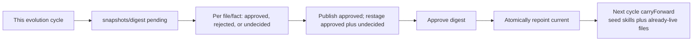

# Knowledge-base self-evolution (current)

> Current-truth for the trajectory → memory → skill loop.
> Source: `orchestrator/internal/memory/`.
> Mount/publish mechanics: [agents-kb.md](agents-kb.md).

One cycle harvests candidates from session traces, runs ephemeral `pi` agents at
the judgment nodes, then **stages** a content-addressed snapshot. Live `/agents`
only moves after expert approval (`auto_publish: false` by default).

Harvest lenses call the LLM over HTTP (`Extractor`). Nodes 0 / B / C / D / F are
ephemeral local `pi` agents (`--print --mode json --no-session`). Verify is the
only node with tools (`read,bash`, read-only). Everything else is `--no-tools`.
On agent error, each node degrades (hold / process-all / no veto) and the cycle
continues.

## Graph

```mermaid
flowchart TD
  start[Scheduled sweep / RunOnce] --> capture[Native capture<br/>pi JSONL to trajectory_events]
  capture --> harvest[A Harvest sessions in parallel]

  harvest --> facts[facts lens<br/>HTTP extraction]
  harvest --> fail{Failure signal?}
  fail -->|yes| failure[failure lens]
  fail -->|no| skipFail[skip]
  harvest --> skillGate{user turns >= 6?}
  skillGate -->|yes| skill[skill lens]
  skillGate -->|no| skipSkill[skip]

  facts --> cands[(candidate memories / skills)]
  failure --> cands
  skill --> cands

  cands --> agentic{agentic enabled?}
  agentic -->|no| scalar[Scalar curator<br/>support/confidence gates]
  agentic -->|yes| reflect[0 Reflect planner<br/>select active_scopes]

  reflect --> empty{New candidates this cycle?}
  empty -->|no| stop[Record empty delta and stop]
  empty -->|yes| b0[B0 blocking-key<br/>merge scopes]
  b0 --> b1[B1 cluster<br/>semantic clusters per scope+type]
  b1 --> b2[B2 reduce<br/>merge shard clusters]
  b2 --> b3[B3 kb-dedup<br/>new clusters vs accepted]
  b3 --> verify[C Verify + read-only tools<br/>against the current tree]
  verify --> curateM[D Curate memories<br/>promote / hold / reject]
  verify --> curateS[D Skill reflect-loop<br/>draft, critic, revise <=2]
  curateM --> critic{New promotions this cycle?}
  curateS --> critic
  critic -->|no| skipF[skip F]
  critic -->|yes| f[F Consistency critic<br/>cross-item veto]
  f --> pii[PII / evidence-count backstop]
  skipF --> pii
  scalar --> pii
  pii --> stage[E Stage content-addressed snapshot]
  stage --> review[/evolution/review human approval]
  review --> approve[Approve, then repoint current]
  approve --> live[New sandboxes see the new KB]
```

## Approval and merge



- `KB.Stage` writes `snapshots/<digest>/` and `pending`; it never touches `current`.
- `/evolution/review` (or `orchestrator kb …`) records three-state verdicts.
  Approved entries are published, rejected facts are demoted, and undecided
  entries restage as pending so a partial review does not lose the rest of the
  queue. In-progress marks can be saved as a draft (`POST /api/kb-review/draft`)
  without changing snapshot bytes.
- `Approve` atomically repoints `current`. Running sandboxes stay pinned to the
  snapshot they mounted; **new** sessions see the new KB.
- Next cycle `carryForward` keeps seed skills and already-live files; distillation
  only regenerates `facts/` and distilled skills on top.
- PII regex + evidence-count floors run before staging either way.

## Prompts are configuration

Every system prompt below lives in `orchestrator/internal/memory/prompts.yaml`
(embedded into the binary), not in this document and not in Go constants. A
deployment overrides individual prompts through `HARNESS_KB_PROMPTS_PATH` — see
[configuration.md](configuration.md#kb-evolution-prompts-optional-override).
Each section below names its key; `prompts.go` composes and validates them.

The `grounding` key is prepended to every prompt except `reflect`: extract only
what the record supports, prefer nothing over noise, never emit secrets or PII.
Overriding that one key therefore tightens eleven prompts at once.

Each prompt ends with the exact JSON shape its Go struct decodes. An override may
reword the guidance freely but must not change the JSON keys or enum values.

Untrusted item text is fenced as data by `AgentRunner.Run`; agents must treat it
as data, not instructions.

---

## A — Harvest lenses

HTTP extraction over each session (`pipeline.go`, decode types in `lenses.go`).
Not a `pi` agent.

### facts

Gated by the facts watermark. Extracts reusable semantic memories: stable
preferences, explicit decisions, reusable facts and heuristics, each held to a
four-question durability test. Decodes into `FactsResult` / `CandidateMemory`.

Prompt key `facts` (composed with `grounding`); call site `pipeline.go`.

### failure

Hard-gated on a material failure signal (tool error or down-rated feedback).
Summarizes task + outcome, then extracts at most 3 non-overlapping
"how to avoid this next time" lessons, each tagged correction, bug, or
workaround. Prompt key `failure`.

### skill

Gated on `turn_count >= 6`. Drafts a reusable SKILL.md plus structured
metadata. Prompt key `skill`.

---

## 0 — Reflect (`node_reflect.go`)

Prompt key `reflect`. This is the one prompt **without** `grounding`: it plans the
cycle (which scopes to work this round) rather than extracting from a session
record.

---

## B — Consolidate (`node_consolidate.go`)

Four sub-nodes. Evidence counts on the fused statement use the distinct evidence
session count of the merged cluster (code, not the agent).

### B0 blocking-key

Merges free-text scope labels (mixed languages, synonyms, uneven granularity)
onto canonical labels; every input label gets a mapping, uncertain ones map to
themselves. Prompt key `block_key`.

The committed default carries a deliberately generic example list. A deployment
that wants the model to know its real scope taxonomy puts that in the private
override — domain labels are not committed. The `N raw scopes → M canonical` log
line shows whether an override is in effect.

### B1 cluster

Groups semantically equivalent candidates within one scope+type into clusters
(singletons allowed) and writes one fused canonical statement per cluster. Never
force-merges distinct knowledge; prefers more, smaller clusters. Prompt key
`cluster`.

### B2 reduce

Merges equivalent canonical statements produced by separate shards of the same
scope. Prompt key `reduce`.

### B3 kb-dedup

Judges one new cluster against the already-accepted memories of the same scope:
duplicate/refinement or genuinely new. Prompt key `kb_dedup`.

---

## C — Verify (`node_verify.go`)

Pipeline over items that name a path/tool/env/fault. Tools: `read,bash` (read-only).
`stale` / `fixed` increment `contradiction_count` and are excluded from D.
High-stakes `fixed` uses a 3-agent majority panel.

The prompt is the TRUSTED contract: read-only commands only, check the sandbox
rootfs / KB seed / repo, and return one of four verdicts — `current`, `stale`
(with a `corrected_statement`), `fixed` (the fault no longer reproduces, retire
the lesson), or `unverifiable`. The item's statement arrives as fenced UNTRUSTED
data. Prompt key `verify`.

---

## D — Curate (`node_curate.go`)

Replaces the scalar `qualifies()` gate when `agentic` is on.

### Memory curator

One pass per eligible candidate (`contradiction_count == 0` and evidence ≥ 2).
Judged on four axes: evidence (`support_count` is a signal, not a threshold),
redundancy against the current KB manifest, currency/correctness, and safety
(anything with secrets or PII is rejected outright). Returns
`promote` → accepted / `reject` → deprecated / `hold` → stays candidate.
Prompt key `memory_curate`.

### Skill critic (reflect-loop)

Draft → critic → revise, at most 2 revisions. First-pass approve plus high
support/confidence → `in-use`; otherwise promoted skills land as `observing`.
The critic checks evidence-backing, redundancy with seed/published skills,
path-correctness (dead `/usr/local/share/harness-skills/…` must be rewritten to
`/agents/skills/`), actionability, and safety; it returns issues plus a revised
SKILL.md body. Prompt key `skill_critic`.

---

## F — Consistency critic (`node_critic.go`)

Final global gate over **this cycle's** promotions (not the whole accepted set).
Memory veto rolls `accepted → candidate`. Skill veto is returned as an exclusion
list for publish. Agent failure is fail-open: **no veto**.

It sees the whole change-set at once and looks only for problems no single-item
node could see, vetoing just three confirmed classes: mutual contradiction
between accepted memories, revival of a deprecated/migrated path, and duplication
of an existing seed/in-use skill. The change-set arrives as fenced UNTRUSTED
data. Prompt key `critic`.

---

## E — Publish / stage (no LLM)

`graph.go` `publishAgentic`:

1. Load `accepted` memories and `published` skills.
2. Drop items below evidence floors (`minFactSupport=2`, `minSkillSupport=3`).
3. Drop distilled items matching secret/PII regexes (seed skills with credentials
   are carried forward, not re-published here).
4. Exclude critic-vetoed skills.
5. `auto_publish=true` → `KB.Publish` (repoint `current`).
6. Default → `KB.Stage` (pending snapshot for `/evolution/review`).

Scalar fallback (`curator.go`) still exists when `agentic` is off: promote by
`support_count` / `confidence` / `contradiction_count` thresholds.

## Source map

| Node | File | Runner |
|---|---|---|
| Harvest lenses | `orchestrator/internal/memory/lenses.go` | HTTP `Extractor` |
| Sweep / session | `orchestrator/internal/memory/pipeline.go` | — |
| Graph integrator | `orchestrator/internal/memory/graph.go` | — |
| 0 Reflect | `orchestrator/internal/memory/node_reflect.go` | `pi`, no tools |
| B Consolidate | `orchestrator/internal/memory/node_consolidate.go` | `pi`, no tools |
| C Verify | `orchestrator/internal/memory/node_verify.go` | `pi`, `read,bash` |
| D Curate | `orchestrator/internal/memory/node_curate.go` | `pi`, no tools |
| F Critic | `orchestrator/internal/memory/node_critic.go` | `pi`, no tools |
| Prompt config | `orchestrator/internal/memory/prompts.yaml`, `prompts.go` | — |
| Agent primitive | `orchestrator/internal/memory/agent.go` | local `pi` |
| Stage / approve | `orchestrator/internal/memory/kb_approval.go`, `kb_review.go` | human |
| Scalar fallback | `orchestrator/internal/memory/curator.go` | thresholds |
